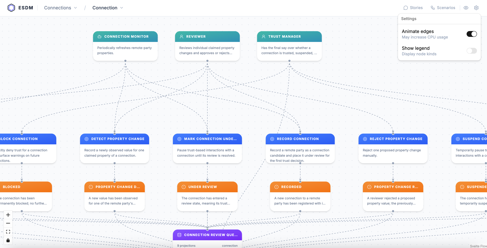
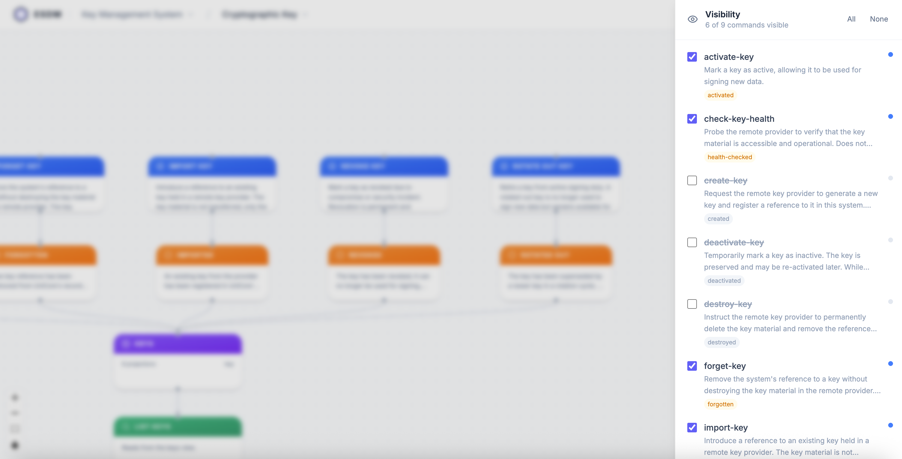
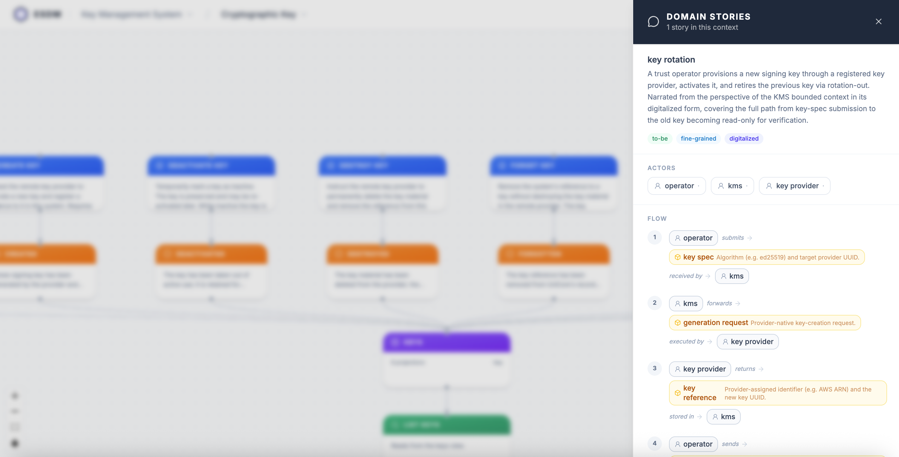
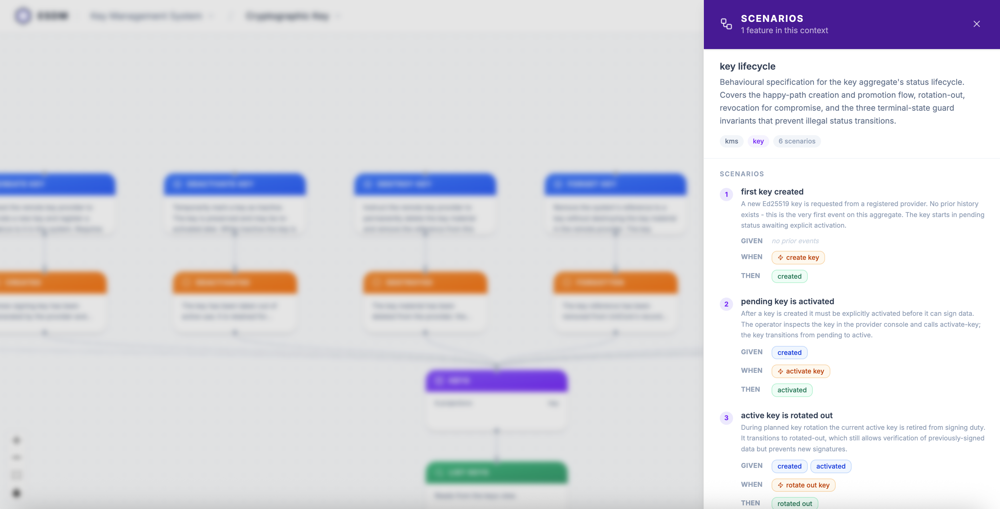

# ESDM Visualizer

Visually browse your domain models created with [esdm](https://www.esdm.io/).

<table>
  <tr>
    <td></td>
    <td></td>
  </tr>
  <tr>
    <td></td>
    <td></td>
  </tr>
</table>

Run the visualizer with Docker against your local ESDM project:

```sh
docker run -p 3000:3000 -v ./examples/shop:/data impierce/esdm-visualizer
```

Go to http://localhost:3000 to start browsing your domain models.

### Develop

```sh
bun install
bun run dev
```

> Make sure the `ESDM_ROOT` in your `.env` point.

### Build Docker image

```sh
docker build -t esdm-visualizer .
```

### Run

```sh
docker run -p 3000:3000 -v ./examples/shop:/data esdm-visualizer
```
